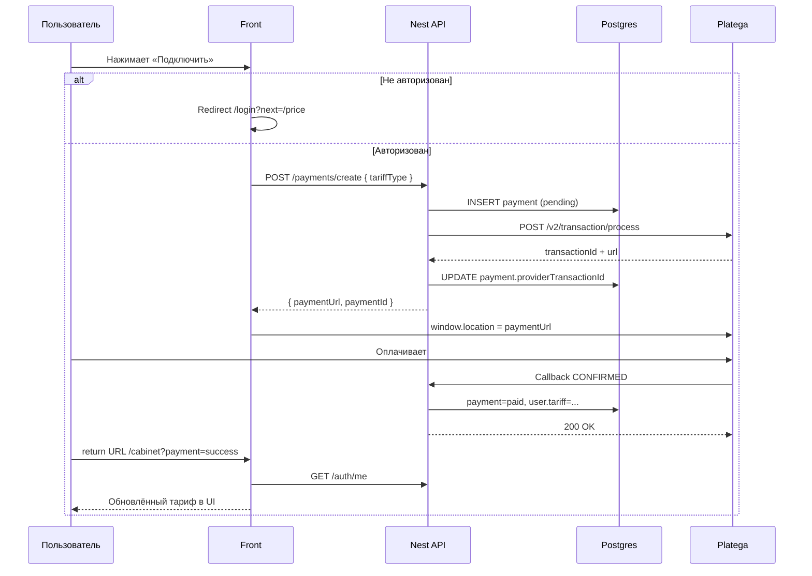

# План внедрения платежей (Platega.io)

Документ описывает пошаговое внедрение приёма платежей через [Platega.io API](https://docs.platega.io/) в стек MindBodyHub (`mindbodyhub-back` / `mindbodyhub-front` / `mindbodyhub-admin`).

---

## 1. Цель

Пользователь выбирает тариф на сайте → оплачивает через Platega → после успешной оплаты тариф активируется автоматически → в админке видна история платежей.

### Критерии готовности (MVP)

- [x] Авторизованный пользователь может начать оплату тарифа с страницы `/price`
- [x] После `CONFIRMED` от Platega у пользователя обновляется тариф
- [x] Повторный callback не дублирует активацию (идемпотентность)
- [x] В админке раздел «Бухгалтерия» показывает список платежей
- [x] Неуспешная/отменённая оплата не меняет тариф
- [ ] Ключи Platega заполнены на бэкенде (и callback URL в ЛК) — **проверить вручную**

---

## 2. Текущее состояние проекта

| Область | Сейчас |
|--------|--------|
| Платежный модуль в Nest | Есть (`payments`) |
| Env-ключи Platega | Поля в `.env`, нужно заполнить секреты |
| Каталог тарифов | `trial` / `popular` / `vip` |
| Тариф пользователя | `free` / `trial` / `popular` / `vip` |
| Доступ к материалам | По `user.tariff` (+ `registered` для авторизованных) |
| Кнопка «Подключить» на `/price` | Создаёт оплату и редиректит на Platega |
| Админка «Бухгалтерия» | Список платежей + фильтры + детали |

**Код MVP готов.** Осталось подключить ключи, выкатить и прогнать боевой/тестовый платёж.

---

## 3. Как устроен Platega (кратко)

- **Base URL:** `https://app.platega.io/`
- **Auth headers:** `X-MerchantId`, `X-Secret` ([авторизация](https://docs.platega.io/))
- **Создание платежа:** `POST /v2/transaction/process`  
  ([без метода оплаты](https://docs.platega.io/%D1%81%D0%BE%D0%B7%D0%B4%D0%B0%D0%BD%D0%B8%D0%B5-%D0%BF%D0%BB%D0%B0%D1%82%D0%B5%D0%B6%D0%BD%D0%BE%D0%B9-%D1%81%D1%81%D1%8B%D0%BB%D0%BA%D0%B8-%D0%B1%D0%B5%D0%B7-%D0%B7%D0%B0%D0%B4%D0%B0%D0%BD%D0%BD%D0%BE%D0%B3%D0%BE-%D0%BC%D0%B5%D1%82%D0%BE%D0%B4%D0%B0-33845703e0) — пользователь сам выбирает способ)
- **Ответ:** `transactionId`, `status: PENDING`, `url` (редирект на оплату), `expiresIn`
- **Статусы:** `PENDING` → `CONFIRMED` / `CANCELED` / `CHARGEBACKED`
- **Callback:** POST на URL из ЛК Platega (настройки) при смене статуса; ожидают `200 OK` быстро, иначе ретраи

### Пример запроса создания транзакции

```http
POST https://app.platega.io/v2/transaction/process
X-MerchantId: <uuid>
X-Secret: <api-key>
Content-Type: application/json
```

```json
{
  "paymentDetails": { "amount": 990, "currency": "RUB" },
  "description": "Тариф Popular — MindBodyHub",
  "return": "https://mindbodyhub.pro/cabinet?payment=success",
  "failedUrl": "https://mindbodyhub.pro/price?payment=fail",
  "payload": "<наш payment.id>",
  "metadata": {
    "userId": "<user.uuid>",
    "userName": "+79001234567"
  }
}
```

`payload` — наш внутренний id платежа (для связки в webhook).  
`metadata.userId` — желательно всегда передавать (антифрод у Platega).

---

## 4. Целевой поток



---

## 5. Модель тарифов (унифицирована)

Единая схема доступа:

| Значение | Где | Смысл |
|----------|-----|--------|
| `free` | материал + пользователь | Общедоступно / бесплатный аккаунт |
| `registered` | только материал | Для любого авторизованного |
| `trial` | материал + пользователь + каталог | Пробный |
| `popular` | материал + пользователь + каталог | Популярный |
| `vip` | материал + пользователь + каталог | VIP |

`users.tariff`: `free` \| `trial` \| `popular` \| `vip`  
(`registered` на пользователе не хранится — выдаётся автоматически при авторизации)

Лестница доступа к материалам: `vip` ⊃ `popular` ⊃ `trial` (+ всегда `free`, и `registered` если залогинен).

Миграция: `mindbodyhub-back/deploy/migrations/002_unify_user_tariffs.sql`  
(старые значения enum `basic` → `trial`, `premium` → `popular`).

### Старое состояние (до унификации)

| Слой | Значения |
|------|----------|
| `tariffs.type` (каталог) | `trial`, `popular`, `vip` |
| `users.tariff` (enum) | `free`, `basic`, `premium` |
| `materials.tariff_type` | `free`, `registered`, или slug из каталога |

### Решение по сроку действия тарифа (зафиксировать в MVP)

Для MVP достаточно:

- при оплате выставлять тариф без `expiresAt`;
- срок/продление — отдельной итерацией (поле `tariffExpiresAt` + cron).

В FAQ/оферте сейчас могут быть обещания про перерасчёт — либо убрать до реализации, либо заложить `expiresAt` сразу (см. фазу 2).

---

## 6. Архитектура модуля `payments`

### 6.1. Структура файлов (бэкенд)

```
mindbodyhub-back/src/payments/
  entities/payment.entity.ts
  dto/create-payment.dto.ts
  dto/platega-callback.dto.ts   # по фактической схеме callback
  payment.types.ts
  payment.mapper.ts
  platega.client.ts             # HTTP-клиент к Platega
  payments.service.ts
  payments.controller.ts
  payments.module.ts
```

Зарегистрировать `PaymentsModule` в `app.module.ts`.

### 6.2. Сущность `Payment`

| Поле | Тип | Описание |
|------|-----|----------|
| `id` | uuid | PK, уходит в Platega `payload` |
| `userId` | uuid | кто платит |
| `tariffType` | varchar | slug тарифа из каталога |
| `tariffId` | uuid \| null | FK на `tariffs.id` (снимок на момент оплаты) |
| `amount` | int | сумма в рублях (целое) |
| `currency` | varchar | `RUB` |
| `status` | enum | `pending` / `paid` / `canceled` / `failed` / `chargeback` |
| `provider` | varchar | `platega` |
| `providerTransactionId` | varchar \| null | id от Platega |
| `paymentUrl` | varchar \| null | ссылка на оплату |
| `description` | varchar | описание в Platega |
| `rawCallback` | jsonb \| null | последний callback (для отладки) |
| `paidAt` | timestamptz \| null | |
| `createdAt` / `updatedAt` | timestamptz | |

Индексы: `userId`, `providerTransactionId` (unique, partial where not null), `status`, `createdAt DESC`.

### 6.3. Env

```env
PLATEGA_BASE_URL=https://app.platega.io
PLATEGA_MERCHANT_ID=
PLATEGA_SECRET=
PLATEGA_SUCCESS_URL=https://mindbodyhub.pro/cabinet?payment=success
PLATEGA_FAIL_URL=https://mindbodyhub.pro/price?payment=fail
# опционально, если Platega даёт отдельный секрет подписи callback:
# PLATEGA_CALLBACK_SECRET=
```

Для локальной разработки:

```env
PLATEGA_SUCCESS_URL=http://localhost:3000/cabinet?payment=success
PLATEGA_FAIL_URL=http://localhost:3000/price?payment=fail
```

Webhook с локальной машины — через туннель (ngrok / cloudflared) или тест на staging.

### 6.4. API бэкенда

| Метод | Путь | Доступ | Назначение |
|-------|------|--------|------------|
| `POST` | `/payments/create` | JWT (user) | Создать платёж + ссылку Platega |
| `GET` | `/payments/me` | JWT (user) | История платежей пользователя (опционально для MVP) |
| `GET` | `/payments/me/:id` | JWT (user) | Статус своего платежа |
| `POST` | `/payments/webhook/platega` | `@Public()` | Callback Platega |
| `GET` | `/payments` | Admin | Список всех платежей (фильтры) |
| `GET` | `/payments/:id` | Admin | Детали |

#### `POST /payments/create`

**Body:**

```json
{ "tariffType": "popular" }
```

**Логика:**

1. Проверить пользователя (`isActive`)
2. Найти активный тариф в каталоге по `type`
3. Распарсить `price` в целое число рублей (нормализовать формат хранения цены — см. §7)
4. Создать `Payment` со статусом `pending`
5. Вызвать Platega `POST /v2/transaction/process`
6. Сохранить `providerTransactionId`, `paymentUrl`
7. Вернуть `{ id, paymentUrl, status, expiresIn }`

**Ошибки:** тариф не найден / неактивен; Platega 400/401; невалидная цена.

#### `POST /payments/webhook/platega`

1. Залогировать тело
2. Найти платёж по `payload` (= наш `id`) или по `transactionId`
3. Если уже `paid` / финальный статус — вернуть `200` (идемпотентность)
4. По статусу:
   - `CONFIRMED` → `paid`, выставить `user.tariff` / `tariffType`, `paidAt = now`
   - `CANCELED` → `canceled`
   - `CHARGEBACKED` → `chargeback` (+ решить: откатывать тариф или только алерт админу)
5. Сохранить `rawCallback`
6. Ответить `200` быстро (< 60 сек по требованиям Platega)

**Безопасность webhook:**

- Не светить секрет в URL
- По возможности проверять IP / подпись / повторный `GET` статуса у Platega перед активацией (рекомендуется: после callback сделать `GET` статуса транзакции и сверить `CONFIRMED`)
- Не доверять `amount` из callback без сверки с нашим `payment.amount`

---

## 7. Нормализация цены тарифа

Сейчас `tariffs.price` — строка (`"990"`, `"990 ₽"`, `"1 990"` — неизвестно, что уже в БД).

**Сделать до интеграции:**

1. Зафиксировать контракт: в БД хранить **только число** (рубли, целое) или отдельное поле `priceAmount: int`
2. Seed и админку привести к одному формату
3. На UI форматировать `"990 ₽"` из числа
4. В `CreatePayment` брать `amount` только из этого поля

Без этого риск создать платёж на неверную сумму.

---

## 8. Клиент Platega (`platega.client.ts`)

Ответственности:

- Сборка headers `X-MerchantId` / `X-Secret`
- `createTransaction(input)` → `POST {BASE}/v2/transaction/process`
- `getTransactionStatus(transactionId)` → `GET ...` (если есть в доке; использовать для подтверждения webhook)
- Таймауты, понятные ошибки Nest (`BadGatewayException` / `BadRequestException`)
- Не логировать `X-Secret`

Конфиг через `ConfigService`.

---

## 9. Фронтенд

### 9.1. Страница тарифов `/price`

1. Загружать тарифы из `GET /tariffs/public` (вместо статического `cardData`, либо синхронизировать)
2. В `PriceCard` кнопка «Подключить»:
   - гость → `/login` с возвратом на `/price`
   - авторизован → `POST /payments/create` → `window.location.assign(paymentUrl)`
3. Состояния кнопки: loading / ошибка (попап как у ContactForm)
4. Если у пользователя уже этот тариф — показать «Активен» / disabled

### 9.2. Return URL

- Success: `/cabinet?payment=success` — попап «Оплата прошла, тариф обновится в течение минуты» + `getProfile()`
- Fail: `/price?payment=fail` — попап «Оплата не завершена»

Важно: return URL **не** является источником истины — активация только по webhook (или по polling статуса).

### 9.3. API-клиент

```ts
// mindbodyhub-front/src/api/api.ts (или payments.ts)
payments.create({ tariffType: 'popular' })
payments.getMy(id)
```

### 9.4. Кабинет

В `UserBar` отображать актуальный тариф после обновления профиля.

---

## 10. Админка

### 10.1. «Бухгалтерия» `/accounting`

Заменить `PlaceholderPage` на `PaymentsPage`:

- Таблица: дата, пользователь (имя/телефон), тариф, сумма, статус, providerTransactionId
- Фильтры: статус, период, поиск по телефону
- Drawer: детали + raw callback (для саппорта)
- Действия MVP: только просмотр (+ опционально «проверить статус в Platega»)

### 10.2. Пользователи

Ручная смена тарифа остаётся как fallback для саппорта.

### 10.3. Тарифы

- Редактирование `price` как числа
- Нельзя удалить тариф, по которому есть `paid` платежи (или soft-delete)

---

## 11. Доступ к материалам после оплаты

После унификации тарифов:

1. В `GET /materials/public` для JWT-пользователя автоматически добавлять его `tariffType` в условие доступа
2. Не полагаться на клиентский `?forTariff=` для обычных пользователей (query можно оставить только для отладки/админа)
3. Проверить, что материалы с `tariff_type = popular|vip|trial` реально открываются после оплаты

---

## 12. Безопасность и надёжность

| Тема | Решение |
|------|---------|
| Секреты | Только backend env, не в Next `NEXT_PUBLIC_*` |
| Идемпотентность webhook | Не активировать повторно, если уже `paid` |
| Подтверждение | Опционально double-check через GET статуса Platega |
| Сумма | Сверять с нашим `payment.amount` |
| Chargeback | Логировать + статус; политика отката тарифа — продуктовое решение |
| Rate limit | На `POST /payments/create` (например, N запросов/мин на user) |
| CORS / webhook | Callback приходит с серверов Platega — отдельный public endpoint |
| Логи | Не писать Secret; payload и transactionId — да |

---

## 13. Этапы внедрения

### Фаза 0 — Подготовка (0.5–1 дн.)

- [x] Унифицировать модель тарифов (`free` / `registered` / `trial` / `popular` / `vip`)
- [x] Положить ключи в `.env` / secrets staging и prod
- [x] В ЛК Platega указать Callback URL: `https://api.mindbodyhub.pro/payments/webhook/platega`
- [ ] Зафиксировать формат `price` в тарифах
- [ ] Уточнить у менеджера Platega: нужна ли обязательная `metadata`, точная схема callback

### Фаза 1 — Backend foundation (1–2 дн.)

- [x] Унификация `users.tariff` + миграция `002_unify_user_tariffs.sql`
- [x] Автодоступ материалов по `user.tariff` (лестница vip ⊃ popular ⊃ trial)
- [x] Entity `Payment` + module
- [x] `PlategaClient`
- [x] `POST /payments/create`
- [x] `POST /payments/webhook/platega` + идемпотентность + активация тарифа
- [x] Admin `GET /payments`
- [ ] Unit/integration smoke: create → mock callback → user.tariff updated
- [x] Заполнить `PLATEGA_MERCHANT_ID` / `PLATEGA_SECRET` в `.env`

### Фаза 2 — Frontend (1 дн.)

- [x] API client
- [x] Кнопка «Подключить» + loading/error popup
- [x] Return URL success/fail UX
- [x] Подтягивание тарифов с `/tariffs/public`
- [x] Автодоступ материалов по тарифу пользователя (сделано на бэкенде)

### Фаза 3 — Admin UI (0.5–1 дн.)

- [x] `PaymentsPage` вместо placeholder «Бухгалтерия»
- [x] Фильтры и детали платежа

### Фаза 4 — Staging / Prod (0.5–1 дн.)

- [x] Админка «Настройки» → блок «Тестовый платёж» (1/2/3 ₽: trial/popular/vip)
- [x] Тестовый платёж на prod (vip 3 ₽) — статус paid, тариф сменился
- [ ] Проверка fail/cancel (отмена оплаты без оплаты)
- [ ] Смоук пользовательского флоу: `/price` → «Подключить» → оплата
- [ ] Доступ к материалам по новому тарифу после оплаты
- [ ] Документировать runbook для саппорта (ручная активация тарифа в админке Users)

### Фаза 5 — После MVP (бэклог)

Подробный план: [payments-phase-5.md](./payments-phase-5.md).

- [x] Срок действия тарифа (`tariffExpiresAt`) и напоминания (UserBar + Web Push)
- [ ] Рекуррентные СБП-подписки Platega (если нужны автопродления)
- [x] Возвраты через Platega API
- [x] Выгрузка транзакций / сверка в «Бухгалтерии»
- [x] Уведомление админу в VK при `CONFIRMED` / `CHARGEBACKED` и новых тикетах
- [x] Нормализация `tariffs.price` в числовое поле `priceAmount` (сейчас парсим строку)

---

## 14. Тест-план

| # | Сценарий | Ожидание |
|---|----------|----------|
| 1 | Гость жмёт «Подключить» | Редирект на логин |
| 2 | User создаёт оплату popular | Payment pending + redirect URL |
| 3 | Callback CONFIRMED | status=paid, user.tariff=popular |
| 4 | Повторный CONFIRMED | Без изменений, 200 |
| 5 | Callback CANCELED | status=canceled, тариф не меняется |
| 6 | Неверный Secret к Platega | Понятная ошибка на create |
| 7 | Неактивный тариф | 400 |
| 8 | Материалы после оплаты | Доступны по новому тарифу |
| 9 | Админ список | Видит платёж со статусом |
| 10 | Chargeback | status=chargeback, политика тарифа по решению |

---

## 15. Риски

| Риск | Митигация |
|------|-----------|
| Расхождение каталога и `users.tariff` | Фаза 0–1, вариант A |
| Строковая цена | Нормализация `priceAmount` |
| Callback не доходит до localhost | Туннель / staging |
| Активация по return URL без webhook | Запретить; только webhook (+ polling) |
| Двойная оплата одного тарифа | Можно разрешить (продление позже) или блокировать pending duplicate |
| Platega меняет схему callback | Хранить `rawCallback`, версионировать DTO |

---

## 16. Рекомендуемый порядок коммитов / PR

1. `fix(tariffs): unify user tariff with catalog types`
2. `feat(payments): add payment entity and Platega client`
3. `feat(payments): create payment + webhook activation`
4. `feat(front): wire tariff purchase button`
5. `feat(admin): accounting payments list`
6. `fix(materials): grant access by user tariff automatically`

---

## 17. Открытые вопросы к продукту / Platega

1. Нужны ли рекуррентные подписки сразу или достаточно разовой оплаты?
2. Что делать при `CHARGEBACKED` — снимать тариф сразу?
3. Обязательна ли `metadata` для нашего MerchantId?
4. Точный JSON callback (поля: `id` / `transactionId` / `payload` / `status`)?
5. Прод-домены для `return` / `failedUrl` / webhook уже финальные?
6. Цены тарифов финальные и в каких единицах (рубли без копеек)?

---

## 18. Ссылки

- [Авторизация Platega](https://docs.platega.io/)
- [Создание платёжной ссылки без метода](https://docs.platega.io/%D1%81%D0%BE%D0%B7%D0%B4%D0%B0%D0%BD%D0%B8%D0%B5-%D0%BF%D0%BB%D0%B0%D1%82%D0%B5%D0%B6%D0%BD%D0%BE%D0%B9-%D1%81%D1%81%D1%8B%D0%BB%D0%BA%D0%B8-%D0%B1%D0%B5%D0%B7-%D0%B7%D0%B0%D0%B4%D0%B0%D0%BD%D0%BD%D0%BE%D0%B3%D0%BE-%D0%BC%D0%B5%D1%82%D0%BE%D0%B4%D0%B0-33845703e0)
- [Создание ссылки с заданным методом](https://docs.platega.io/%D1%81%D0%BE%D0%B7%D0%B4%D0%B0%D0%BD%D0%B8%D0%B5-%D0%BF%D0%BB%D0%B0%D1%82%D0%B5%D0%B6%D0%BD%D0%BE%D0%B9-%D1%81%D1%81%D1%8B%D0%BB%D0%BA%D0%B8-%D1%81-%D0%B7%D0%B0%D0%B4%D0%B0%D0%BD%D0%BD%D1%8B%D0%BC-%D0%BC%D0%B5%D1%82%D0%BE%D0%B4%D0%BE%D0%BC-29203843e0)

---

*Документ можно уточнять после ответа менеджера Platega по схеме callback и обязательности metadata.*
